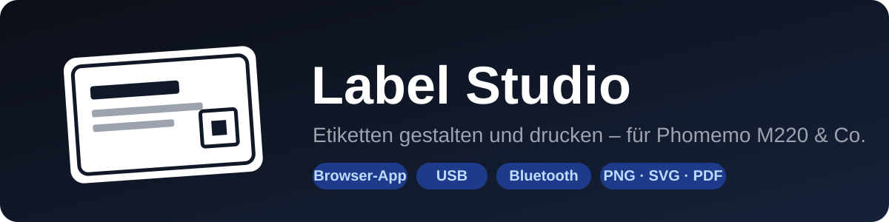

  

  <b>Eine eigene Etiketten-App für deinen Etikettendrucker – am PC und am Handy, direkt im Browser.</b> 
  Keine Installation, alles in einer einzigen HTML-Datei.

  <a href="https://barry2040.github.io/open-label-studio/"><b>▶ App öffnen: barry2040.github.io/open-label-studio</b></a>

> [!WARNING]
> **Vibe-coded:** Dieses Projekt ist mit KI-Unterstützung (Claude) im „Vibe Coding“ entstanden – also im Gespräch,
> Schritt für Schritt, ohne klassische Code-Reviews oder automatisierte Tests. Es kann daher **Fehler enthalten**.
> Getestet wurde nur das, was in den Tabellen unten als „getestet“ markiert ist. Nutzung auf eigene Gefahr –
> Fehler und Verbesserungen gerne als [Issue](https://github.com/Barry2040/open-label-studio/issues) melden.

---

## ✨ Funktionen

| | |
|---|---|
| 🖊️ **Gestalten** | Text, QR-Code, Barcode, Bild, Rahmen, Linie, Formen (Kreis, Pfeil, Stern, Herz …) und Symbole (⚠ ♻ ❄ …) – verschieben, skalieren, um 90° drehen |
| 🔤 **Schriften** | 20 Web-Schriften mit Vorschau (Google Fonts, abschaltbar), eigene Schriftdateien (TTF/OTF/WOFF) und installierte PC-Schriften; Text im Bogen, Zeilen- und Zeichenabstand, unter-/durchgestrichen, „Einpassen“ füllt das Etikett |
| 🖼️ **Vorlagen-Galerie** | Fertige Etiketten (Filamentspule, Kabel-Fahne, Gewürzglas, Preisschild …), passend zur Etikettengröße |
| 🧮 **Seriendruck** | Liste einfügen oder CSV laden – ein Etikett pro Zeile, Spalten als `{1}`, `{2}` … |
| 🖱️ **Bedienung** | Mehrfachauswahl mit Ausrichten/Verteilen, Rechtsklick-Menü, auf dem Handy Fenster als Tabs, Hell/Dunkel umschaltbar |
| 🗂️ **Ebenen** | Alle Elemente als Liste wie in Photoshop: auswählen, ausblenden, sperren, umsortieren, umbenennen |
| 📐 **Präzise** | Lineal in mm, zuschaltbares Raster (1/2/5 mm) mit Einrasten, Rückgängig/Wiederholen (Strg+Z/Y) |
| 📥 **Importieren** | Fertige Etiketten als PNG, SVG oder PDF, z. B. von [3dfilamentprofiles.com](https://3dfilamentprofiles.com) |
| 🔢 **Platzhalter** | `{datum}`, `{zeit}` und `{nr}` – die Nummer zählt bei mehreren Kopien hoch |
| 🕘 **Zuletzt gedruckt** | Die letzten 10 gedruckten Etiketten mit einem Klick zurückholen |
| 💾 **Vorlagen & Sicherung** | Vorlagen speichern; Export/Import überträgt Vorlagen, Rollen, Einstellungen und Fensteranordnung auf andere Geräte |
| 🔗 **Teilen** | Etikett per Link oder QR-Code aufs Handy holen – einfach scannen |
| 🧻 **Rollen** | Profile je Etikettenrolle: Größe, Papierformat und Versatz mit einem Klick |
| 🔄 **Druckerwechsel** | Beim Wählen oder Verbinden eines Druckers stellt sich das passende Etikett ein – Text, Rahmen und Bilder skalieren automatisch mit |
| 🖨️ **Drucken** | Über den Windows-Treiber per USB oder direkt per Bluetooth, Versatz in X und Y einstellbar |
| 🔋 **Druckerstatus** | Akku, Papier und Deckel per Bluetooth (Phomemo, Niimbot; Marklife meldet nur Probleme), mit Warnung vor dem Druck |
| 🧩 **Arbeitsfläche** | Fenster frei anordnen und in der Breite ziehen, mit Einrasten an Kanten |
| ❓ **Hilfe** | Anleitung, Treiber-Infos und Fehlerbehebung im Menü **„Label Studio“** oben links |

## 🖨️ Unterstützte Drucker

| Hersteller | Modelle | Verbindung |
|---|---|---|
| **Phomemo** | M220 ✅, M221, M200, M110 / M120, M110S | Bluetooth, USB (Windows-Treiber) |
| **Marklife** | P15 / P7 ✅, P12, M60 | Bluetooth |
| **Niimbot** | D101 ✅, D110, B1 | Bluetooth |
| **Alle anderen** | jeder Etikettendrucker mit Windows-Treiber | USB über den Windows-Druck |

✅ = mit einem echten Gerät getestet. Details zu Druckbreite, Etikett und Teststatus stehen unter [Bluetooth](#-bluetooth).

## 🚀 Loslegen

**Online:** [barry2040.github.io/open-label-studio](https://barry2040.github.io/open-label-studio/) in **Chrome** oder **Edge** öffnen – am PC wie am Handy.

**Offline:** [`label-studio/label-studio.html`](label-studio/label-studio.html) herunterladen und im Browser öffnen.

Dann Etikettengröße wählen, gestalten, drucken.

## 🖨️ Drucken am PC (USB)

Funktioniert mit **jedem Etikettendrucker, für den es einen Windows-Treiber gibt** – die App nutzt einfach den normalen Windows-Druck.

1. Den Windows-Treiber deines Druckers **von der offiziellen Seite des Herstellers** installieren (siehe [Treiber & Software](#-treiber--software)) und den Drucker per USB anschließen.
2. In der App **„Über Windows-Drucker drucken (USB)“** klicken.
3. Im Druckfenster einstellen:

   | Einstellung | Wert |
   |---|---|
   | Ziel | dein Etikettendrucker |
   | Papierformat | wie in der App bzw. das passende Etikett im Treiber |
   | Ränder | Keine |
   | Skalierung | 100 |

> [!TIP]
> Bietet der Treiber deine Etikettengröße nicht an, wähle in der App unter **„Papierformat im Treiber“** das nächstgrößere Format – die App setzt das Etikett dann mittig auf die Seite. Beispiel: Der Phomemo-M220-Treiber kennt nur 50 × 30 und 50 × 70 mm, 40 × 30-Etiketten landen so mittig auf 50 × 30.

## 📶 Bluetooth

Funktioniert in **Chrome/Edge** am PC, **Chrome** auf Android und mit der App **Bluefy** auf dem iPhone – am Handy nur, wenn die App über `https` läuft.

| Modell | Druckbreite | Standard-Etikett | Lage des Etiketts | Bluetooth |
|---|---|---|---|---|
| Phomemo M220 | 72 mm | 40 × 30 mm | rechts | ✅ getestet (Android) |
| Phomemo M221 | 72 mm | 40 × 30 mm | mittig | ungetestet |
| Phomemo M200 | 76 mm | 50 × 30 mm | mittig | ungetestet |
| Phomemo M110 / M120 | 48 mm | 40 × 30 mm | mittig | ungetestet |
| Phomemo M110S | 48 mm | 40 × 30 mm | rechts | ungetestet |
| Marklife P15 / P7 (auch LP15, S15 …) | 12–15 mm | 40 × 12 mm | quer | ✅ getestet (PC) |
| Marklife P12 (auch LP90, P11) | 12–15 mm | 40 × 15 mm | quer | ungetestet |
| Marklife M60 (auch X2) | bis 50 mm | 50 × 30 mm | quer | ungetestet |
| Niimbot D110 | 12 mm | 40 × 12 mm | quer | ungetestet |
| Niimbot D101 | 24 mm | 40 × 12 mm | quer | ✅ getestet (PC + Android) |
| Niimbot B1 | 48 mm | 50 × 30 mm | längs | ungetestet |

> [!TIP]
> ✅ **Mit echten Geräten getestet:** **Phomemo M220** per Bluetooth mit Android (Chrome), **Marklife P15** per Bluetooth am PC (Chrome/Edge unter Windows) und **Niimbot D101** per Bluetooth am PC und mit Android – Verbinden und Drucken funktionieren. Einfach [barry2040.github.io/open-label-studio](https://barry2040.github.io/open-label-studio/) öffnen.

> [!NOTE]
> Unter Windows scheitert die Bluetooth-Kopplung mit dem M220 – dort per USB drucken. Die Phomemo-Modelle sind nach dem Open-Source-Projekt [phomymo](https://github.com/transcriptionstream/phomymo) eingestellt, die **Marklife**-Modelle nach [thermoprint](https://github.com/tomLadder/thermoprint) von tomLadder (MIT-Lizenz), die **Niimbot**-Modelle nach [niimbluelib](https://github.com/MultiMote/niimbluelib) von MultiMote (MIT-Lizenz, Grundlage von [NiimBlue](https://github.com/MultiMote/niimblue)). Marklife- und Niimbot-Drucker werden beim Verbinden automatisch erkannt; ihre Etiketten (z. B. 40 × 12 mm) gestaltest du einfach im Querformat, die App dreht das Bild selbst.

## 🖨️ Dein Drucker fehlt?

In der App im Menü **„Label Studio“ → „Drucker vorschlagen …“** – oder direkt hier: [**🖨️ Drucker vorschlagen**](https://github.com/Barry2040/open-label-studio/issues/new?template=drucker-wunsch.yml). Wer vorher „Verbinden“ ausprobiert, schickt die Bluetooth-Diagnose gleich mit – das hilft beim Einbauen. Dafür ist ein kostenloses GitHub-Konto nötig.

## 🔒 Datenschutz

Die Datei enthält keine persönlichen Daten. Etiketten, Vorlagen und Einstellungen speichert die App **nur im Browser** des jeweiligen Geräts – sie landen weder in der Datei noch auf GitHub.

Die Web-Schriften kommen von **Google Fonts**, die Bibliotheken für QR-Code, Barcode und PDF von **cdnjs** – dabei sieht der jeweilige Anbieter wie bei jeder Webseite deine IP-Adresse. Etikett-Inhalte werden nicht übertragen.
Google Fonts lässt sich im Menü unter **„Schriften …“** abschalten; dann wird nichts von Google geladen. Eigene Schriftdateien bleiben nur im Browser gespeichert.

## 🌐 Online

Die App läuft über **GitHub Pages** unter **[barry2040.github.io/open-label-studio](https://barry2040.github.io/open-label-studio/)**. Jede Änderung auf `main` wird automatisch veröffentlicht (Workflow `.github/workflows/pages.yml`).

## 📚 Treiber & Software

Nur offizielle Seiten der Hersteller – bitte Treiber nicht von Drittanbieter-Seiten laden.

| Hersteller | Offizielle Downloads |
|---|---|
| **Phomemo** | [phomemo.com/pages/drivers](https://phomemo.com/pages/drivers) – Windows-/Mac-Treiber je Modell |
| **Marklife** | [marklifeprinter.com/Download.html](https://www.marklifeprinter.com/Download.html) – Treiber je Modell (Windows, Mac, Linux) |
| **Niimbot** | [niimbot.com – Download-Center](https://www.niimbot.com/de/downloadCenter) – Windows-/Mac-Software und Treiber |

Für den Bluetooth-Druck aus Label Studio ist **kein Treiber nötig** – der wird nur für den USB-Druck über Windows gebraucht.

## 🙏 Quellen & Danke

Die Bluetooth-Befehle der Drucker stammen aus diesen Open-Source-Projekten:

| Projekt | Autor | Verwendet für | Lizenz |
|---|---|---|---|
| [phomymo](https://github.com/transcriptionstream/phomymo) | transcriptionstream | Phomemo M-Serie (M220, M221, M200, M110 …) | keine angegeben |
| [thermoprint](https://github.com/tomLadder/thermoprint) | tomLadder | Marklife P15 / P7, P12, M60 | MIT |
| [niimbluelib](https://github.com/MultiMote/niimbluelib) | MultiMote | Niimbot D110, D101, B1 (Grundlage von [NiimBlue](https://github.com/MultiMote/niimblue)) | MIT |

Mitgeladene Bibliotheken:

| Bibliothek | Wofür | Lizenz |
|---|---|---|
| [qrcode-generator](https://github.com/kazuhikoarase/qrcode-generator) | QR-Codes | MIT |
| [JsBarcode](https://github.com/lindell/JsBarcode) | Barcodes | MIT |
| [PDF.js](https://github.com/mozilla/pdf.js) (Mozilla) | PDF-Import | Apache 2.0 |
| [Google Fonts](https://fonts.google.com) | Web-Schriften und Symbol-Schrift (Noto Sans Symbols) | SIL Open Font License / Apache 2.0 |

Phomemo, Marklife und Niimbot sind Marken ihrer jeweiligen Inhaber. Label Studio ist ein unabhängiges Projekt und steht in keiner Verbindung zu diesen Herstellern.
